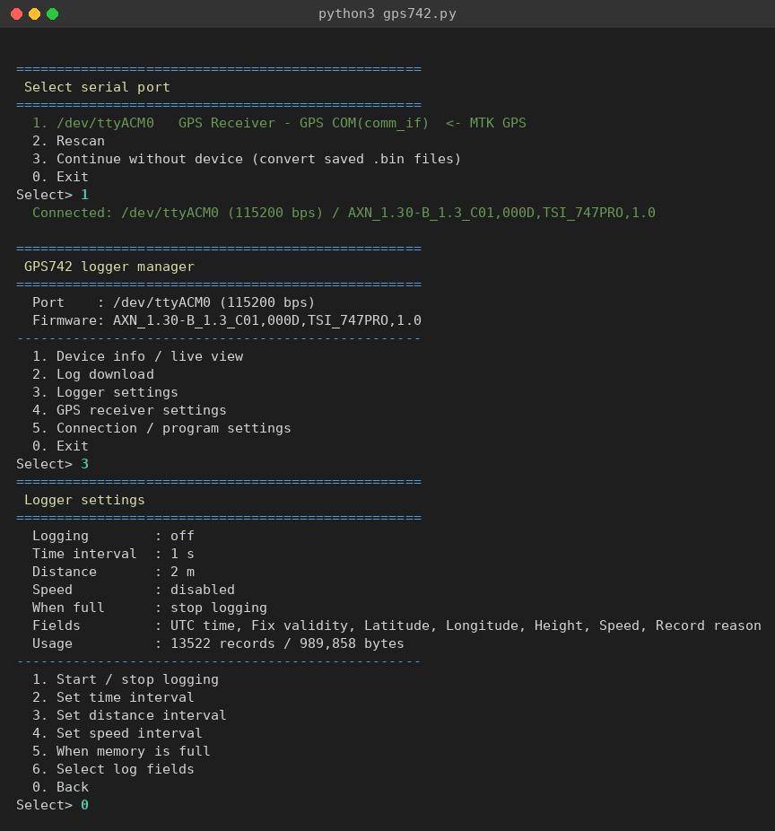
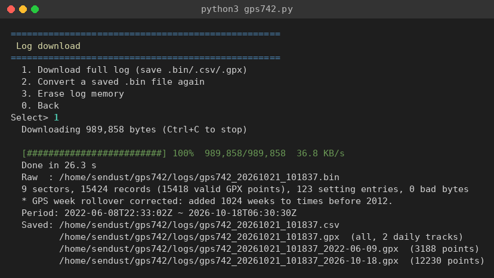

# gps742_ascen

Command-line tool for the **Ascen GPS742** GPS data logger (MTK chipset).
It talks to the logger over USB serial using NMEA/PMTK commands to read and
change logger settings, download the log memory, and convert it to CSV and GPX.


## Features

- Serial port list at startup: pick the logger, then enter the top menu
- Number-driven menus: type a number and press Enter, `0` goes back (exits at the top menu)
- Device info, live position status, raw NMEA view, hot/warm/cold restart
- Full log download with per-block checksum check and retry
- Converts the raw dump to CSV and GPX (one track per local date, plus one GPX file per date)
- Logger settings: start/stop logging, time/distance/speed interval, overwrite or stop when full, log fields
- GPS receiver settings: NMEA output sentences, fix rate, SBAS, DGPS
- GPS week rollover correction (see [Device notes](#device-notes))

## Requirements

- Python 3.8+
- [pyserial](https://pypi.org/project/pyserial/)

```bash
pip install -r requirements.txt     # or: sudo apt install python3-serial
```

On Linux the logger shows up as `/dev/ttyACM0` (USB `0e8d:3329`, `cdc_acm` driver).
Your user must be in the `dialout` group to open it:

```bash
sudo usermod -aG dialout $USER     # then log out and back in
```

## Usage

```bash
python3 gps742.py                       # choose the serial port from a list
python3 gps742.py -p /dev/ttyACM0       # skip the port list
python3 gps742.py -p /dev/ttyACM0 -b 115200
python3 gps742.py --convert logs/gps742_YYYYmmdd_HHMMSS.bin   # convert only, no device
```

Downloaded files are written to `logs/` next to the script:

| File | Content |
|---|---|
| `gps742_<date>_<time>.bin` | raw log memory dump |
| `gps742_<date>_<time>.json` | logger settings at download time |
| `gps742_<date>_<time>.csv` | all records |
| `gps742_<date>_<time>.gpx` | all valid points, one `<trk>` per local date |
| `gps742_<date>_<time>_<YYYY-MM-DD>.gpx` | one file per local date |

## Menu structure

```
Select serial port
├── 1..N  serial ports (MTK GPS is marked)
├── Rescan
├── Continue without device (convert saved .bin files)
└── 0 Exit

GPS742 logger manager
├── 1 Device info / live view
│   ├── 1 Device info
│   ├── 2 Live position status
│   ├── 3 Raw NMEA view
│   ├── 4 Hot restart
│   ├── 5 Warm restart
│   └── 6 Cold restart
├── 2 Log download
│   ├── 1 Download full log (save .bin/.csv/.gpx)
│   ├── 2 Convert a saved .bin file again
│   └── 3 Erase log memory
├── 3 Logger settings
│   ├── 1 Start / stop logging
│   ├── 2 Set time interval
│   ├── 3 Set distance interval
│   ├── 4 Set speed interval
│   ├── 5 When memory is full (overwrite / stop)
│   └── 6 Select log fields
├── 4 GPS receiver settings
│   ├── 1 NMEA output sentences
│   ├── 2 Fix rate
│   ├── 3 SBAS on / off
│   └── 4 DGPS mode
├── 5 Connection / program settings
│   ├── 1 Change port / baud rate
│   ├── 2 Reconnect
│   ├── 3 GPS week rollover fix (auto / off)
│   ├── 4 Download block size
│   └── 5 Output folder
└── 0 Exit
```

Settings screens show the current values read from the device each time they are opened.
Erasing the log memory asks you to type `erase`; restarts ask for `yes`.
In prompts that ask for a value, an empty Enter cancels.

## Screenshots

Port selection, top menu and logger settings:



Log download:



## Protocol summary

All commands are `$<body>*<XOR checksum>\r\n`.

| Command | Purpose |
|---|---|
| `PMTK605` → `PMTK705` | firmware version |
| `PMTK182,2,<n>` → `PMTK182,3,<n>,<v>` | read logger parameter (2 format, 3 time, 4 distance, 5 speed, 6 method, 7 status, 8 next write address, 9 flash ID, 10 record count) |
| `PMTK182,1,<n>,<v>` | set logger parameter |
| `PMTK182,4` / `PMTK182,5` | start / stop logging |
| `PMTK182,6,1` | erase log memory |
| `PMTK182,7,<addr>,<len>` → `PMTK182,8,<addr>,<hex>` | read log memory |
| `PMTK314` / `PMTK414` | set / query NMEA output |
| `PMTK220` / `PMTK400` | set / query fix rate |
| `PMTK313` / `PMTK413` | set / query SBAS |
| `PMTK301` / `PMTK401` | set / query DGPS mode |
| `PMTK101` / `102` / `103` | hot / warm / cold restart |

Commands are acknowledged with `$PMTK001,<cmd>,[<sub>,]<flag>` (3 = success).
Time, distance and speed intervals are stored in units of 0.1 s, 0.1 m and 0.1 km/h.

## Device notes

Observed on a GPS742 with firmware `AXN_1.30-B_1.3_C01,000D,TSI_747PRO,1.0`:

- **GPS week rollover.** The receiver reports dates 1024 weeks (about 19.6 years) in the past,
  e.g. 2007-03-06 for 2026-10-20. Times before 2012 are shifted forward by 1024 weeks.
  This can be turned off in *Connection / program settings*.
- **Every other sector is used.** The log memory is made of 64 KB sectors, and every second
  sector is blank (all `0xFF`). The parser skips blank sectors.
- **Corrupted sector header.** Sector 0 may carry a wrong format value in its header.
  When a sector cannot be decoded with its header format, the current device format is tried.
- **Large reads can hang the firmware.** Interrupting a 64 KB read left the logger unresponsive
  until the USB cable was reconnected. The tool reads 2 KB blocks, waits for each acknowledgement,
  and drains pending output before retrying.
- Old tracks stay in memory until it is erased, so a download can contain several trips.
  Use the per-date GPX files when importing into a map app.
