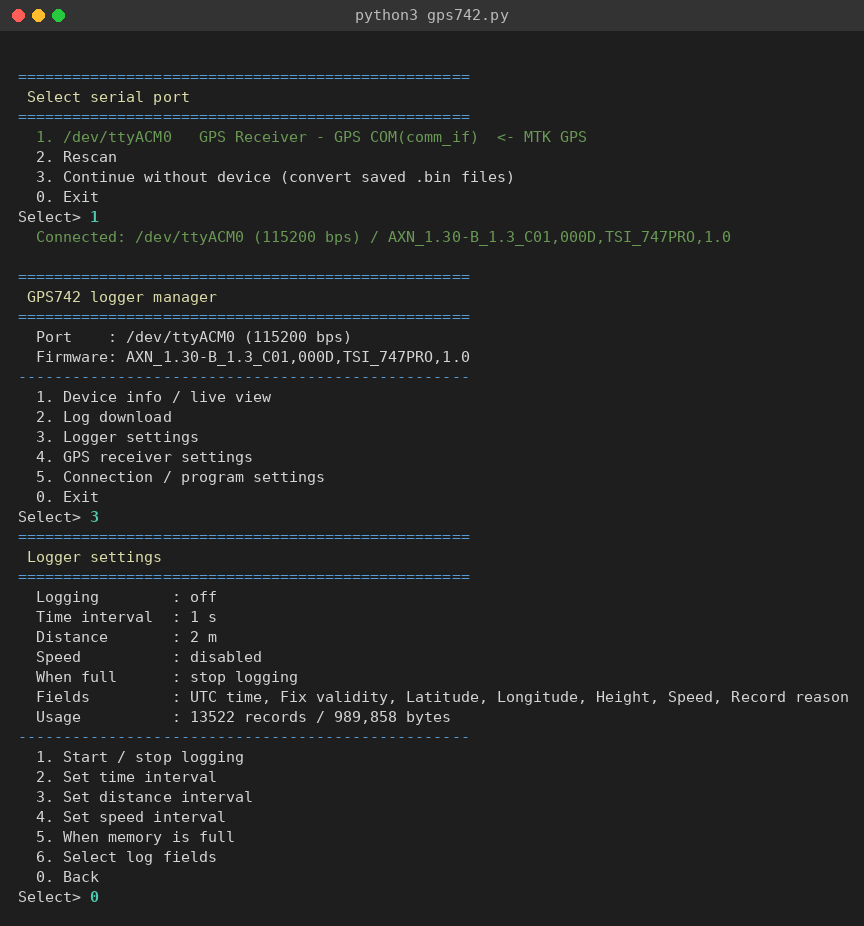
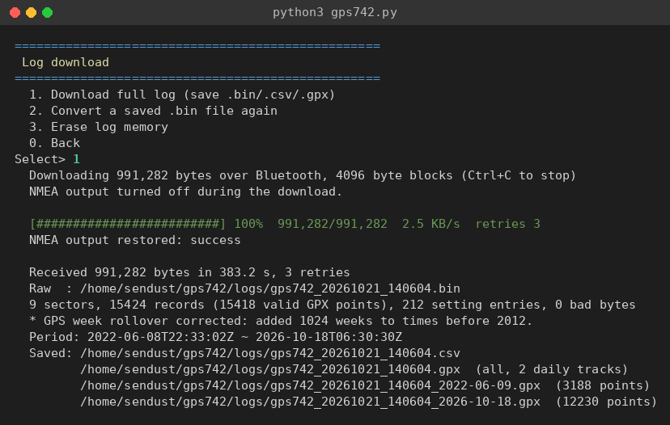

# gps742_ascen

Command-line tool for the **Ascen GPS742** GPS data logger (MTK chipset).
It talks to the logger over USB serial using NMEA/PMTK commands to read and
change logger settings, download the log memory, and convert it to CSV and GPX.


## Features

- Serial port list at startup: pick the logger, then enter the top menu
- Number-driven menus: type a number and press Enter, `0` goes back (exits at the top menu)
- Device info, live position status, raw NMEA view, hot/warm/cold restart
- Full log download with per-block checksum check and retry; a block that stops partway keeps
  what arrived and only the rest is requested again
- Older TSI loggers download at 460800 bps over USB/serial, about 2.5 times faster (see [Older loggers](#older-loggers))
- Converts the raw dump to CSV and GPX (one track per local date, plus one GPX file per date)
- Logger settings: start/stop logging, time/distance/speed interval, overwrite or stop when full, log fields
- Beep and vibration sensor on / off (newer loggers, see [Older loggers](#older-loggers))
- Restore factory defaults: logger settings plus a full cold restart for the GPS receiver settings
- GPS receiver settings: NMEA output sentences, fix rate, SBAS, DGPS
- AGPS: download 7-day EPO data from the internet (or load a file) and upload it to the logger
- GPS week rollover correction (see [Device notes](#device-notes))

## Requirements

- Python 3.8+
- [pyserial](https://pypi.org/project/pyserial/)

```bash
pip install -r requirements.txt     # or: sudo apt install python3-serial
```

On Linux the logger shows up as `/dev/ttyACM0` (USB `0e8d:3329`, `cdc_acm` driver).
Your user must be in the `dialout` group to open it:

```bash
sudo usermod -aG dialout $USER     # then log out and back in
```

## Usage

```bash
python3 gps742.py                       # choose the serial port from a list
python3 gps742.py -p /dev/ttyACM0       # skip the port list
python3 gps742.py -p /dev/ttyACM0 -b 115200
python3 gps742.py --convert logs/gps742_YYYYmmdd_HHMMSS.bin   # convert only, no device
python3 gps742.py -V                    # show the script revision and exit
```

The script revision is printed at startup and shown in the main menu header. It is the
`REVISION` constant near the top of `gps742.py`: the date and time of the last feature
change or improvement, updated by hand with each change (not taken from the file time).

Downloaded files are written to `logs/` next to the script:

| File | Content |
|---|---|
| `gps742_<date>_<time>.bin` | raw log memory dump |
| `gps742_<date>_<time>.json` | logger settings at download time |
| `gps742_<date>_<time>.csv` | all records |
| `gps742_<date>_<time>.gpx` | all valid points, one `<trk>` per local date |
| `gps742_<date>_<time>_<YYYY-MM-DD>.gpx` | one file per local date |

## Bluetooth

The GPS742 also offers a Bluetooth serial port (SPP). It works for settings and the live view,
but downloads are slower (about 3 KB/s, roughly 5.5 minutes for 1 MB, versus about 30 s over USB)
and the logger's Bluetooth module can stall in the middle of a transfer.
**Use USB for downloads when you can.**

Linux:

```bash
sudo rfcomm bind 0 <logger MAC address>      # creates /dev/rfcomm0 (group dialout)
python3 gps742.py                            # pick "/dev/rfcomm0  Bluetooth serial ..."
```

Windows: pair the logger in Bluetooth settings. Windows then creates two COM ports for it,
an *outgoing* one (used to connect to the logger) and an *incoming* one. The port list shows
the outgoing port with the logger's address and marks the incoming port as not usable:

```
  2. COM5           Standard Serial over Bluetooth link (COM5)  <- Bluetooth 00:1C:88:13:04:F8
  4. COM6           Standard Serial over Bluetooth link (COM6)  (Bluetooth incoming port - cannot connect)
```

Both are recognised from the `BTHENUM\...` device instance ID; the outgoing port carries the
remote address, the incoming port carries `000000000000`.

On a Bluetooth port the tool switches to a slower, safer mode:

- waits up to 15 s for the link and retries the connection up to 3 times
- 4 KB blocks, no pause between requests by default (*Bluetooth pause between requests*,
  0-2 s; raise it to 0.3 s if your adapter stalls); the block size never changes
- NMEA output is turned off during the download and restored afterwards
- fast give-up: a block that does not arrive within a few seconds is retried once
  (*Bluetooth quick retries*, 0-5), and a stalled write gives up at once
- after that the data received so far is kept and the tool asks you to
  **power-cycle the logger, reconnect and resume** from the address where it stopped.
  You can also resume without reconnecting, save a `_partial` dump, or discard it
- optional *Bluetooth slow command write* (off by default): each command is sent in 6-byte
  pieces with a 0.1 s pause after each piece, as Ascen's gpsPhotoTagger does in its fast
  download mode, so the module's input buffer is not overrun. Sending one request then takes
  about 0.5 s. With a Realtek RTL8761BU dongle on Linux the GPS742 did not stall even without it
  and without a pause (see below), so it stays off; turn it on if your adapter stalls

Measured on Linux with a Realtek RTL8761BU USB dongle, 88 KB log, 4 KB blocks:

| Slow command write | Pause | Time | Result |
|---|---|---|---|
| off | 0.3 s | 27.2 s (3.3 KB/s) | complete, 0 retries |
| on | 0 s | 33.5 s | complete, 0 retries |
| off | 0 s (default) | 20.7 s (4.3 KB/s) | complete, 0 retries, 6 runs in a row (about 530 KB) |

The stalls described above were seen with an earlier setup; with this adapter they did not occur.

A stalled Bluetooth transfer does not recover on its own (seen on both Linux and Windows),
and smaller blocks do not help, so the recovery path is always a power cycle and a reconnect.

If a download was cut off while NMEA output was off, the next connection warns about it;
use *GPS receiver settings > Restore default NMEA output*.

ModemManager probes new serial ports with AT commands and can disturb the logger.
If you do not use a modem, exclude rfcomm ports:

```bash
echo 'KERNEL=="rfcomm*", ENV{ID_MM_DEVICE_IGNORE}="1"' | sudo tee /etc/udev/rules.d/99-mm-ignore-rfcomm.rules
sudo udevadm control --reload
```

## AGPS (EPO)

*GPS receiver settings > Update AGPS (EPO) data* downloads the 7-day MediaTek EPO file
(`MTK7d.BIN`, the source used by Ascen's own gpsPhotoTagger) or loads one from disk, checks it
(28 sets of 6 hours, satellites 1-32), saves the download to the output folder and uploads it.
The upload takes about 2 s over USB. Bluetooth works too, but is slower and can stall, so use USB.
The download address is `CONFIG["epo_url"]` in `gps742.py`.

All three AGPS items first query `PMTK607`; a receiver that rejects or ignores it is reported as
not supporting AGPS, and nothing is downloaded or sent to it.

*AGPS (EPO) status* shows the period the data covers and whether the receiver is using it.
The receiver uses EPO only once it knows the current time, which this firmware takes from the
satellites (it does not accept the time from the PC, `PMTK740`).

## Menu structure

```
Select serial port
├── 1..N  serial ports (MTK GPS is marked)
├── Rescan
├── Continue without device (convert saved .bin files)
└── 0 Exit

GPS742 logger manager
├── 1 Device info / live view
│   ├── 1 Device info
│   ├── 2 Live position status
│   ├── 3 Raw NMEA view
│   ├── 4 Hot restart
│   ├── 5 Warm restart
│   └── 6 Cold restart
├── 2 Log download
│   ├── 1 Download full log (save .bin/.csv/.gpx)
│   ├── 2 Convert a saved .bin file again
│   └── 3 Erase log memory
├── 3 Logger settings
│   ├── 1 Start / stop logging
│   ├── 2 Set time interval
│   ├── 3 Set distance interval
│   ├── 4 Set speed interval
│   ├── 5 When memory is full (overwrite / stop)
│   ├── 6 Select log fields
│   ├── 7 Beep on / off
│   ├── 8 Vibration sensor on / off
│   └── 9 Restore factory defaults
├── 4 GPS receiver settings
│   ├── 1 NMEA output sentences
│   ├── 2 Restore default NMEA output
│   ├── 3 Fix rate
│   ├── 4 SBAS on / off
│   ├── 5 DGPS mode
│   ├── 6 AGPS (EPO) status
│   ├── 7 Update AGPS (EPO) data
│   └── 8 Clear AGPS (EPO) data
├── 5 Connection / program settings
│   ├── 1 Change port / baud rate
│   ├── 2 Reconnect
│   ├── 3 GPS week rollover fix (auto / off)
│   ├── 4 Download block size (USB)
│   ├── 5 Download block size (Bluetooth)
│   ├── 6 Bluetooth quick retries (0-5)
│   ├── 7 Bluetooth pause between requests (0-2 s)
│   ├── 8 Bluetooth slow command write (on / off)
│   ├── 9 Fast download for older loggers (on / off)
│   └── 10 Output folder
└── 0 Exit
```

Settings screens show the current values read from the device each time they are opened.
Erasing the log memory asks you to type `erase`; restarts and restoring factory defaults ask for `yes`.
If the erase acknowledgement does not arrive (seen over Bluetooth on Windows: the memory was erased
but the reply was lost), the tool reads the record count: 0 is reported as erased, otherwise it
offers to send the erase command again.
In prompts that ask for a value, an empty Enter cancels.

## Screenshots

Port selection, top menu and logger settings over Bluetooth (`/dev/rfcomm0`):



Log download over Bluetooth (4 KB blocks, NMEA output off during the transfer):



## Protocol summary

All commands are `$<body>*<XOR checksum>\r\n`.

| Command | Purpose |
|---|---|
| `PMTK605` → `PMTK705` | firmware version |
| `PMTK182,2,<n>` → `PMTK182,3,<n>,<v>` | read logger parameter (2 format, 3 time, 4 distance, 5 speed, 6 method, 7 status, 8 next write address, 9 flash ID, 10 record count) |
| `PMTK182,1,<n>,<v>` | set logger parameter |
| `PMTK182,4` / `PMTK182,5` | start / stop logging |
| `PMTK182,6,1` | erase log memory |
| `PMTK182,7,<addr>,<len>` → `PMTK182,8,<addr>,<hex>` | read log memory |
| `PMTK182,14,<baud>` | change the serial speed until the next change or a power cycle (older TSI loggers, no acknowledgement) |
| `PMTK314` / `PMTK414` | set / query NMEA output |
| `PMTK220` / `PMTK400` | set / query fix rate |
| `PMTK313` / `PMTK413` | set / query SBAS |
| `PMTK301` / `PMTK401` | set / query DGPS mode |
| `PMTK314,-1` | restore default NMEA output |
| `PMTK000` | test command (link check) |
| `PMTK101` / `102` / `103` | hot / warm / cold restart |
| `PMTK104` | full cold restart, resets GPS receiver settings (not logger settings) |
| `PMTK607` → `PMTK707` | AGPS (EPO) status: sets, first/last set, sets in use (GPS week, time of week) |
| `PMTK127` | clear AGPS (EPO) data |
| `PMTK253,1,0` | switch to binary mode for the EPO upload |
| `PTSI003,0` / `PTSI003,2,<v>` → `PTSI003,1,<v>` | query / set beep (1 on, 0 off) |
| `PTSI004,0` / `PTSI004,2,<v>` → `PTSI004,1,<v>` | query / set vibration sensor (1 on, 0 off) |

The EPO upload uses MTK binary packets: `04 24`, length (u16 LE, whole packet), command (u16 LE),
payload, XOR of length..payload, `0D 0A`. Command 722 carries a sequence number (u16) and three
60-byte satellite records; the logger answers command 2 with the sequence number and 1 (accepted).
Sequence `0xFFFF` ends the upload, and command 253 with payload `00` + baud rate (u32) returns
to NMEA mode.

The `PTSI` commands are TSI vendor commands, found in Ascen's gpsPhotoTagger (the *Turn on Buzzer*
and *Turn on Vibration Detector* check boxes). Query and set are both answered with the current value.

Commands are acknowledged with `$PMTK001,<cmd>,[<sub>,]<flag>` (3 = success).
Time, distance and speed intervals are stored in units of 0.1 s, 0.1 m and 0.1 km/h.

## Device notes

Observed on a GPS742 with firmware `AXN_1.30-B_1.3_C01,000D,TSI_747PRO,1.0`:

- **GPS week rollover.** The receiver reports dates 1024 weeks (about 19.6 years) in the past,
  e.g. 2007-03-06 for 2026-10-20. Times before 2012 are shifted forward by 1024 weeks.
  This can be turned off in *Connection / program settings*.
- **Every other sector is used.** The log memory is made of 64 KB sectors, and every second
  sector is blank (all `0xFF`). The parser skips blank sectors.
- **Corrupted sector header.** Sector 0 may carry a wrong format value in its header.
  When a sector cannot be decoded with its header format, the current device format is tried.
- **Large reads can hang the firmware.** Interrupting a 64 KB read left the logger unresponsive
  until the USB cable was reconnected. The tool reads 2 KB blocks, waits for each acknowledgement,
  and drains pending output before retrying.
- **Bluetooth stalls.** The Bluetooth module stops sending when commands arrive back-to-back:
  with no pause between download requests it stalled within a few requests, with 0.1 s after
  about 110 KB. The GPS chip keeps answering over USB, and only a power cycle of the logger
  brings the Bluetooth link back. With a 0.3 s pause a full download succeeded. (Seen with an
  earlier adapter; with a Realtek RTL8761BU dongle no pause was needed, see [Bluetooth](#bluetooth).)
- **Bluetooth throughput.** Each request costs about 0.1 s plus about 0.22 s per KB (the dump is
  sent as hex text), so the link tops out near 4.5 KB/s. Measured with a 0.3 s pause:
  512 B blocks 1.0 KB/s, 1 KB 1.6 KB/s, 2 KB 2.35 KB/s, 4 KB 3.1 KB/s.
- **NMEA output settings survive a power cycle.** A download that is cut off while NMEA output
  is off leaves it off.
- **Factory defaults.** `PMTK104` resets GPS receiver settings (e.g. DGPS mode back to WAAS/SBAS)
  but leaves the logger settings unchanged. *Restore factory defaults* therefore also writes the
  logger values from `FACTORY_DEFAULTS` in `gps742.py`: fields `0x0002003F` (UTC, valid, lat, lon,
  height, speed, RCR), 1 s, 2 m, speed disabled, stop logging when full. Edit that table if your
  unit ships with different values.
- **AGPS.** EPO data is stored with the full GPS week number (2026 data is accepted despite the
  rollover). An EPO set with no data for a satellite has id 0 in that record.
- Old tracks stay in memory until it is erased, so a download can contain several trips.
  Use the per-date GPX files when importing into a map app.
- **Binary log download is not supported.** gpsPhotoTagger has a second download path for other
  models: `PMTK253,1,<baud>` (binary mode), then `$LOG_DATA_READ,<n>,<n>` as plain text for each
  64 KB sector, answered with 65,540 bytes. Tested over USB on 2026-11-02: the GPS742 enters
  binary mode but only sends its 1 Hz binary position packets (command 1000), and the TSI747CD
  ignores `PMTK253` and keeps sending NMEA. Neither sends log data, so the tool keeps using
  `PMTK182,7` (hex text).

## Older loggers

An older TSI logger (firmware `B-core_1.1,0004,TSI747CD,1.0`, connected through a CP2102
USB-serial bridge as `/dev/ttyUSB0`, 115200 bps) works with this tool for logger settings and
log download, but it has no AGPS, beep or vibration sensor:

- `PMTK607` is answered with `$PMTK001,607,1` (invalid command), so the AGPS items report
  "not supported" and send nothing.
- `PTSI003` / `PTSI004` get no answer, so *Logger settings* shows beep and vibration as
  "not supported". The first time the screen opens it waits about 6 s for the answers; after
  that the result is remembered until you reconnect.

### Fast download (older loggers)

Ascen's gpsPhotoTagger downloads loggers with firmware `B-core_` 1.1 or later (or `M-core_` 2.0
or later) at 460800 bps, and this tool does the same on USB/serial ports:

1. `PMTK182,14,460800`, wait 0.2 s, reopen the port at 460800 bps and check that `PMTK605` is answered
2. read the log in 32 KB blocks
3. `PMTK182,14,115200` and back to 115200 bps, also when the download fails or is interrupted

At 460800 bps the logger drops commands that arrive in one piece, so every command is sent in
6-byte pieces with 0.1 s after each piece (as gpsPhotoTagger does). The logger answers at once.

Measured on the TSI747CD (63 KB): 115200 bps with 2 KB blocks 13.3 s (4.6 KB/s), 115200 bps with
32 KB blocks 12.1 s (5.1 KB/s), 460800 bps with 32 KB blocks 4.8 s (12.8 KB/s), same data.

If the program stops during a fast download, the logger stays at 460800 bps until it is
power-cycled. On the next connection the tool notices this, switches it back and says so.
The GPS742 (`AXN_1.30` firmware) is not switched; over USB it is fast anyway.
*Connection / program settings > Fast download for older loggers* turns this off.
